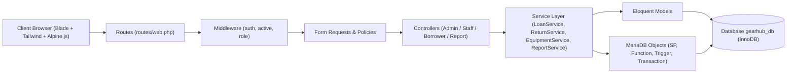

# 3. Arsitektur Aplikasi — GearHub

## 3.1 Pola Arsitektur (Layered MVC + Service Layer)
GearHub dirancang dengan pemisahan tanggung jawab (*Separation of Concerns*) yang tegas agar kode mudah dipahami, diuji, dipelihara, dan dipertanggungjawabkan saat sidang UKK:

---

## 3.2 Penjelasan Setiap Lapisan

1. **Routing & Middleware (`routes/web.php`, `app/Http/Middleware/`)**:
   - Seluruh endpoint dikelompokkan berdasarkan prefix role (`/admin/*`, `/staff/*`, `/borrower/*`, `/reports/*`) menggunakan *Named Routes*.
   - `EnsureActiveUser` memastikan pengguna yang akunnya dinonaktifkan oleh Admin otomatis keluar dari sesi pada request berikutnya.
   - `CheckRole` menolak akses lintas role secara tegas di sisi backend dengan kode HTTP `403 Forbidden`.

2. **Form Request Validation & Authorization Policy (`app/Http/Requests/`, `app/Policies/`)**:
   - Validasi input tidak menumpuk di Controller, melainkan dipisahkan ke 8 kelas `FormRequest` khusus dengan pesan Bahasa Indonesia yang informatif.
   - `LoanPolicy` dan `ReturnPolicy` menjamin seorang Peminjam hanya dapat melihat atau membatalkan transaksi miliknya sendiri (mencegah celah *Insecure Direct Object Reference / IDOR*).

3. **Thin Controllers (`app/Http/Controllers/`)**:
   - Controller dibagi ke dalam namespace `Admin\`, `Staff\`, `Borrower\`, serta `AuthController` dan `ReportController`.
   - Tugas Controller dibatasi hanya menerima request tervalidasi, memanggil `Service`, dan mengembalikan `View` atau `RedirectResponse`.

4. **Business Service Layer (`app/Services/`)**:
   - `LoanService`: Mengelola siklus pembuatan pinjaman, persetujuan via `CALL sp_approve_loan`, penolakan, penyerahan fisik, pembatalan aman tanpa kebocoran stok, serta sinkronisasi status `overdue`.
   - `ReturnService`: Mengelola pengajuan pengembalian, pratinjau denda via `fn_calculate_fine`, dan verifikasi pemeriksaan fisik via `CALL sp_process_return` di dalam transaksi `BEGIN / COMMIT / ROLLBACK`.
   - `EquipmentService`: Mengelola CRUD peralatan, manajemen file foto pada disk `public`, penjagaan invarian stok saat edit, dan pemulihan unit selesai perbaikan (`restoreDamagedUnits`).
   - `ReportService`: Menyusun query teroptimasi (*Eager Loading*) dan struktur tabel untuk 7 jenis laporan.
   - `ActivityLogService`: Mencatat aktivitas aplikasi lengkap dengan metadata pelaku, modul, referensi ID, nilai lama/baru, IP address, dan user agent.

5. **Presentation Layer (`resources/views/`)**:
   - Komponen Blade reusable (`<x-icon>`, `<x-status-badge>`, `<x-empty-state>`, `<x-toast>`) menjaga konsistensi UI tanpa duplikasi kode.
   - Partial `partials/return-verification-panel.blade.php` dipakai bersama oleh Admin dan Petugas untuk menjaga satu standar antarmuka inspeksi fisik pengembalian.
