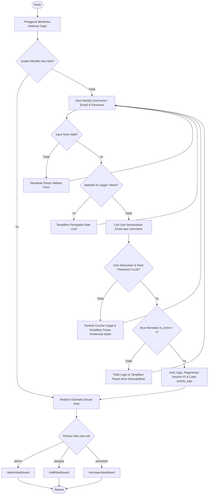

# 6. Flowchart & Pseudocode — Proses Login

## 6.1 Diagram Alur (Flowchart) Login Berdasarkan Role



---

## 6.2 Pseudocode Proses Autentikasi (`AuthController@login`)

```text
PROCEDURE Login(identity, password, remember, client_ip)
BEGIN
    IF identity IS EMPTY OR password IS EMPTY THEN
        RETURN ValidationError("Username/email dan kata sandi wajib diisi")
    END IF

    throttle_key <- LOWER(identity) + "|" + client_ip
    IF RateLimiter.tooManyAttempts(throttle_key, 5) THEN
        RETURN Error("Terlalu banyak percobaan login gagal")
    END IF

    IF IsEmailFormat(identity) THEN
        user <- SELECT * FROM users WHERE email = identity LIMIT 1
    ELSE
        user <- SELECT * FROM users WHERE username = identity LIMIT 1
    END IF

    IF user IS NULL OR NOT BcryptVerify(password, user.password) THEN
        RateLimiter.hit(throttle_key, 60)
        RETURN Error("Username/email atau kata sandi salah")
    END IF

    IF user.is_active == FALSE THEN
        RETURN Error("Akun sedang dinonaktifkan")
    END IF

    RateLimiter.clear(throttle_key)
    Session.authenticate(user, remember)
    Session.regenerateId()
    ActivityLogService.log("login", "Pengguna berhasil login", "auth", user.id)

    SWITCH user.role
        CASE "admin":    REDIRECT "/admin/dashboard"
        CASE "petugas":  REDIRECT "/staff/dashboard"
        CASE "peminjam": REDIRECT "/borrower/dashboard"
    END SWITCH
END
```
