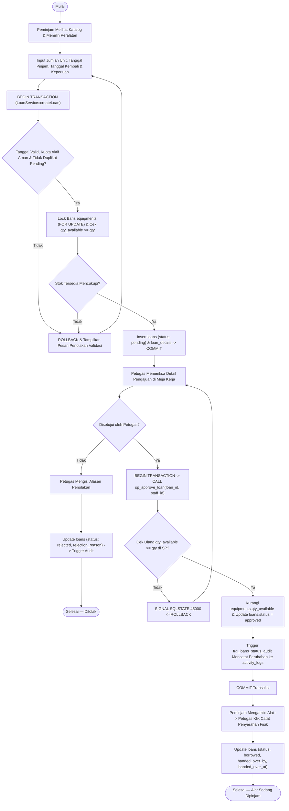

# 7. Flowchart & Pseudocode — Proses Peminjaman Alat

## 7.1 Diagram Alur (Flowchart) Siklus Peminjaman



---

## 7.2 Pseudocode Proses Pengajuan & Persetujuan Peminjaman

```text
PROCEDURE CreateLoan(user_id, loan_date, due_date, purpose, items[])
BEGIN
    BEGIN TRANSACTION
    TRY
        IF due_date < loan_date OR (due_date - loan_date) > settings.max_loan_days THEN
            THROW DomainException("Rentang tanggal tidak sesuai ketentuan")
        END IF

        FOR EACH item IN items DO
            IF ExistsPendingSameEquipment(user_id, item.equipment_id) THEN
                THROW DomainException("Masih ada pengajuan pending untuk alat yang sama")
            END IF

            eq <- SELECT * FROM equipments WHERE id = item.equipment_id FOR UPDATE
            IF eq.status != "tersedia" OR eq.qty_available < item.qty THEN
                THROW DomainException("Stok peralatan tidak mencukupi")
            END IF
        END FOR

        loan <- INSERT INTO loans(code, user_id, loan_date, due_date, purpose, status="pending")
        FOR EACH item IN items DO
            INSERT INTO loan_details(loan_id, equipment_id, qty, condition_before)
        END FOR

        COMMIT
        RETURN loan
    CATCH error
        ROLLBACK
        RETHROW error
    END TRY
END

PROCEDURE ApproveLoan(loan_id, staff_id)
BEGIN
    BEGIN TRANSACTION
    TRY
        CALL sp_approve_loan(loan_id, staff_id)
        -- Di dalam sp_approve_loan:
        -- 1. Lock loans FOR UPDATE, pastikan status = 'pending'
        -- 2. Loop setiap loan_details, lock equipments FOR UPDATE
        -- 3. Kurangi qty_available = qty_available - qty
        -- 4. Update loans SET status = 'approved', approved_by = staff_id, approved_at = NOW()
        -- 5. Trigger trg_loans_status_audit otomatis menulis audit ke activity_logs
        ActivityLogService.log("loan_approved", ...)
        COMMIT
    CATCH error
        ROLLBACK
        RETHROW error
    END TRY
END
```
