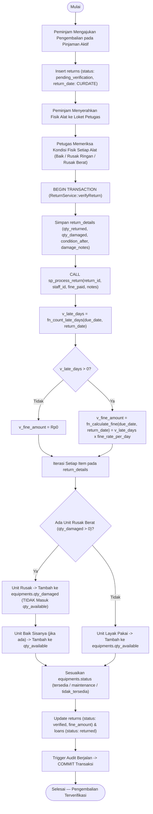

# 8. Flowchart & Pseudocode — Pengembalian Alat & Perhitungan Denda

## 8.1 Diagram Alur (Flowchart) Pengembalian & Denda



---

## 8.2 Pseudocode Perhitungan Denda & Pembaruan Stok (`sp_process_return`)

```text
FUNCTION fn_calculate_fine(due_date, return_date) RETURNS DECIMAL(12,2)
BEGIN
    late_days <- MAX(0, DATEDIFF(return_date, due_date))
    IF late_days == 0 THEN
        RETURN 0.00
    END IF

    fine_rate <- SELECT CAST(value AS DECIMAL) FROM settings WHERE key = 'fine_rate_per_day'
    IF fine_rate IS NULL THEN
        fine_rate <- 5000.00
    END IF

    RETURN late_days * fine_rate
END

PROCEDURE sp_process_return(return_id, staff_id, fine_paid, notes)
BEGIN
    ret  <- SELECT * FROM returns WHERE id = return_id FOR UPDATE
    loan <- SELECT * FROM loans WHERE id = ret.loan_id FOR UPDATE

    late_days   <- fn_count_late_days(loan.due_date, ret.return_date)
    fine_amount <- fn_calculate_fine(loan.due_date, ret.return_date)

    FOR EACH detail IN (SELECT * FROM return_details WHERE return_id = return_id) DO
        good_qty <- detail.qty_returned - detail.qty_damaged
        eq <- SELECT * FROM equipments WHERE id = detail.equipment_id FOR UPDATE

        new_avail   <- eq.qty_available + good_qty
        new_damaged <- eq.qty_damaged + detail.qty_damaged
        -- Catatan Penting: Unit rusak berat TIDAK dikembalikan ke qty_available

        UPDATE equipments
        SET qty_available = new_avail,
            qty_damaged   = new_damaged,
            status        = IF(new_avail > 0, 'tersedia', IF(new_damaged > 0, 'maintenance', 'tidak_tersedia'))
        WHERE id = eq.id
    END FOR

    UPDATE returns SET status = 'verified', verified_by = staff_id, late_days = late_days, fine_amount = fine_amount
    UPDATE loans   SET status = 'returned'
END
```
